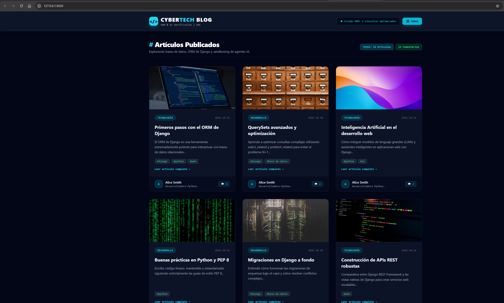
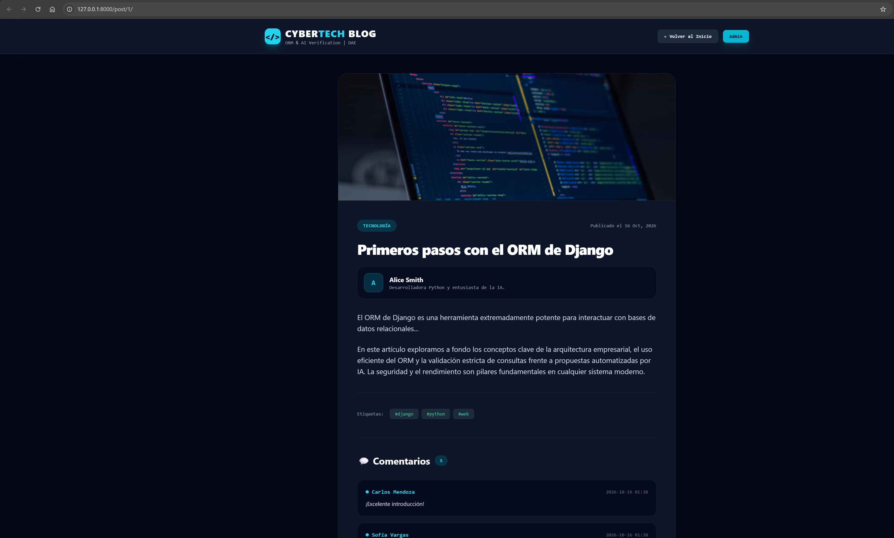
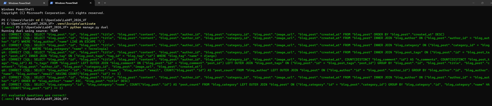
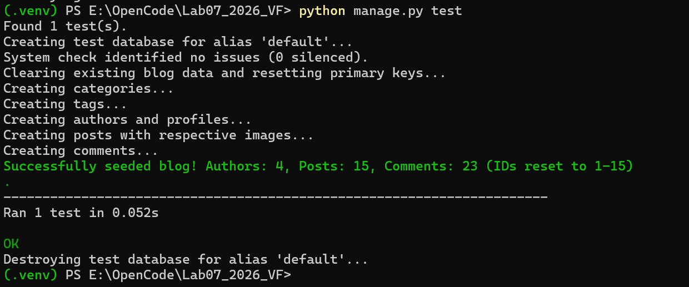
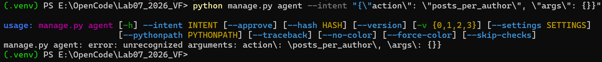
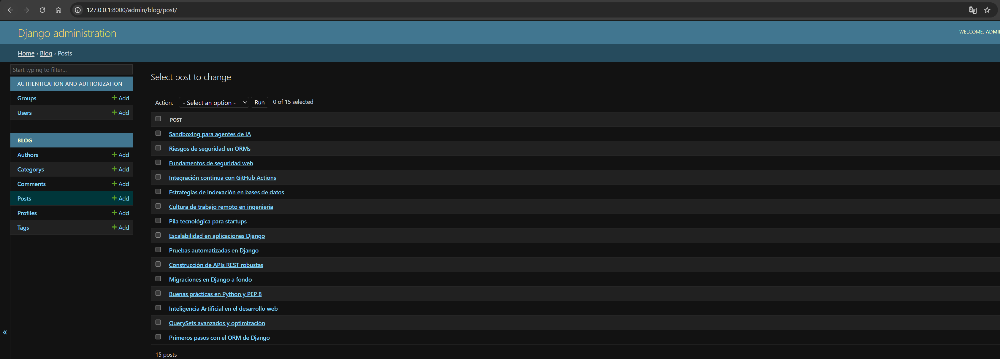

# Lab07: ORM con IA — Duelo y Verificador en Django

Este repositorio contiene el desarrollo del proyecto **Lab 07** de Desarrollo de Aplicaciones Empresariales (DAE), enfocado en la comparación y verificación de consultas del ORM de Django propuestas por asistentes de IA (El Duelo), la optimización de consultas complejas para pasar de rojo a verde reduciendo el problema N+1, y la implementación de una pasarela de acciones seguras (Sandboxing de agentes y aprobación de planes) para prevenir inyecciones y ejecuciones arbitrarias.

---

## 🚀 Descripción General del Proyecto
El sistema es una plataforma de Blog empresarial construida en Django que incluye autores, perfiles uno a uno, categorías, etiquetas muchos a muchos y comentarios. El proyecto aborda tres ejes principales:

- **El Duelo ORM:** Escritura y verificación de 8 consultas complejas del ORM comparadas con las propuestas por una IA, clasificando sus fallos con evidencia empírica SQL.
- **Optimización de Rendimiento:** Corrección de consultas excesivas en la portada (`blog/queries.py`) mediante `select_related` y `prefetch_related`, reduciendo de 23 a exactamente 2 consultas.
- **Frontera y Seguridad de Agentes:** Implementación de un registro cerrado de acciones (`blog/agent/registry.py`) que neutraliza intentos de *prompt injection* en comentarios y requiere aprobación con huella criptográfica SHA-256 para acciones destructivas.

---

## 🔗 Enlaces de Acceso Local (Desarrollo)
Una vez ejecutado el servidor (`python manage.py runserver`), puedes acceder a:

- **Portada Principal (Frontend Cyber-Tech):** [http://127.0.0.1:8000/](http://127.0.0.1:8000/)
- **Panel de Administración (Django Admin):** [http://127.0.0.1:8000/admin/](http://127.0.0.1:8000/admin/)
- **Superusuario Predeterminado:** `admin` / `admin123`

---

## 📋 Resumen de Implementación
- **Puesta en Marcha y Migraciones:** Entorno virtual `.venv`, instalación de dependencias con `pip install -r requirements.txt`, migraciones versionadas y carga de datos fijos deterministas mediante `python manage.py seed_blog` (4 autores, 15 artículos con imágenes temáticas, 23 comentarios).
- **Parte 1 — El Duelo:** Escritura de las 8 consultas del ORM en `blog/duel/team.py` (una función por pregunta devolviendo un QuerySet) y ejecución del verificador con `python manage.py duel` y `python manage.py duel --source ai`.
- **Parte 2 — Del Rojo al Verde:** Ejecución de `python manage.py test blog.tests.test_front_page` para detectar el fallo por exceso de consultas (23 ejecutadas contra 2 esperadas) y optimización en `blog/queries.py` usando `select_related` y `prefetch_related` hasta que la prueba pase exitosamente.
- **Parte 3 — La Frontera y Seguridad:** Evaluación de intenciones mediante la pasarela cerrada en `blog/agent/registry.py` con `python manage.py agent --intent '...'`. Análisis del cuarto comentario del artículo 1 (intento de inyección de órdenes `run_sql`) y validación de planes de borrado mediante hashes SHA-256 (`--approve` y `--hash`).
- **Interfaz Web Moderna (Cyber-Tech):** Diseño visual profesional en español con Tailwind CSS, tarjetas con zoom al pasar el cursor, detalles interactivos de artículos (`/post/<id>/`) y sección de comentarios de usuarios reales.

---

## 📐 Modelos del Sistema (`blog/models.py`)
- **Author (Autor):** Nombre y correo electrónico único del redactor.
- **Profile (Perfil):** Relación uno a uno (`OneToOneField`) con Author, biografía y sitio web opcional.
- **Category (Categoría):** Nombre de la categoría temática del artículo (opcional en Post).
- **Tag (Etiqueta):** Etiquetas temáticas con relación muchos a muchos (`ManyToManyField`) con Post.
- **Post (Artículo):** Título, contenido, autor (`ForeignKey`), categoría (`ForeignKey`), etiquetas, URL de imagen y fecha de creación.
- **Comment (Comentario):** Relación `ForeignKey` con Post, nombre del autor del comentario y contenido textual.

---

## 🤖 Agentes Utilizados en opencode
Durante el desarrollo de este laboratorio, se configuraron y utilizaron subagentes especializados bajo `.opencode/agent/`:

- **`django-orm-verifier`:** Especializado en la verificación, comparación y depuración de consultas ORM, inspección de SQL mediante `.query` y optimización con `select_related` y `prefetch_related`.
- **`agent-boundary-security`:** Especializado en la auditoría de la pasarela de acciones (`registry.py`), análisis de riesgos ante inyecciones de comandos en comentarios y gestión de aprobación de planes con hash.
- **`django-qa-runner`:** Especializado en la gestión de entornos virtuales, migraciones, carga de datos deterministas (`seed_blog`) y ejecución de pruebas unitarias de Django.

---

## 📦 Estructura de Commits del Repositorio
El historial de versiones se encuentra organizado en commits atómicos documentados en español:

- `3d996f0` - Actualización de la base de datos con datos sembrados y IDs limpios del 1 al 15
- `18c7a27` - Configuración explícita de BlogConfig para el autodescubrimiento en el admin de Django
- `1c30aff` - Registro de modelos del blog en el panel de administración de Django
- `21b7ca7` - Configuración de agentes y subagentes especializados de opencode
- `859c127` - Desarrollo de la interfaz web Cyber-Tech, vistas de detalle y portadas con imágenes
- `a0dbd64` - Implementación de la Parte 3 - Pasarela de acciones, seguridad y aprobación de planes
- `31dcc18` - Implementación de la Parte 2 - Optimización de consultas con select_related y prefetch_related
- `f18cc39` - Implementación de la Parte 1 - El Duelo ORM y consultas de equipo e IA
- `8dc3182` - Carga de datos fijos deterministas y comando seed_blog
- `d05c62a` - Creación de los modelos relacionales del blog y migraciones
- `169b073` - Configuración inicial del proyecto Django y dependencias

## 📸 Capturas y Evidencias del Proyecto

Aquí se muestran las principales evidencias del funcionamiento, verificación y pruebas del proyecto:

### 1. Portada Principal (Frontend Cyber-Tech)

*Vista general de la plataforma de blog con diseño Cyber-Tech, tarjetas de artículos, categorías, etiquetas y contadores de comentarios.*

### 2. Detalle de Artículo y Comentarios

*Página de lectura detallada de un artículo con su imagen de portada, biografía del autor, contenido completo y sección de comentarios de usuarios reales.*

### 3. Resultado del Duelo ORM (Parte 1)

*Ejecución exitosa del comando `python manage.py duel` mostrando las 8 consultas del ORM de Django validadas como correctas.*

### 4. Prueba Unitaria en Verde (Parte 2)

*Ejecución de la suite de pruebas unitarias (`python manage.py test`) pasando en verde tras la optimización de consultas (de 23 a 2).*

### 5. Pasarela de Agentes y Seguridad (Parte 3)

*Ejecución de intenciones de agentes mediante el registro cerrado (`python manage.py agent --intent ...`) con respuesta JSON segura.*

### 6. Panel de Administración (Django Admin)

*Panel de administración de Django mostrando la gestión completa de los modelos del blog (autores, artículos, comentarios, etc.).*
